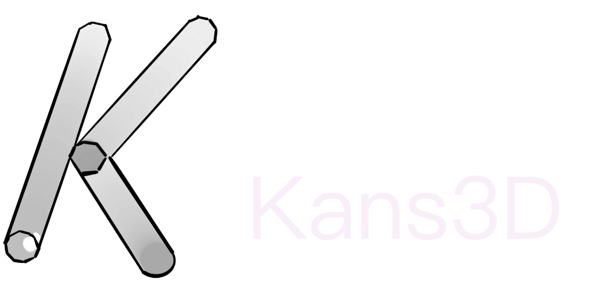
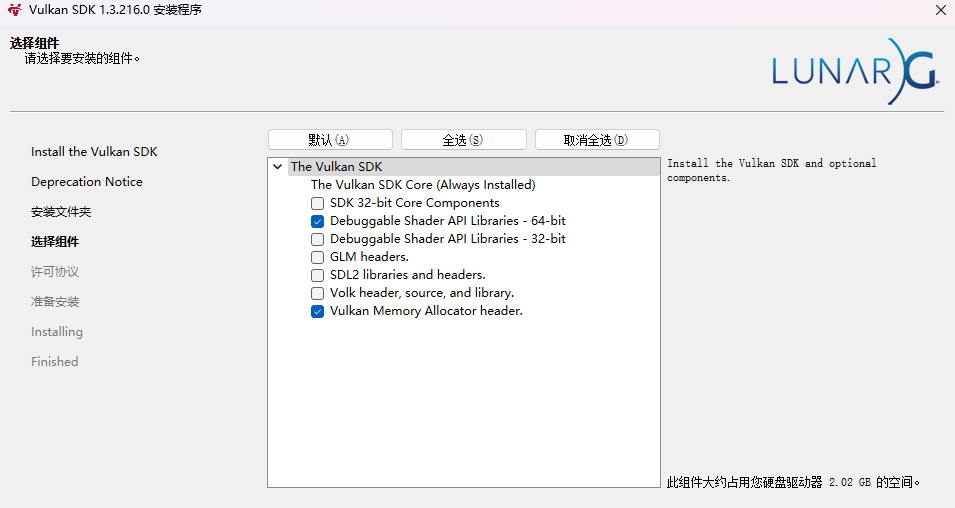

# Kans3D Engine

<p align="center">
  <a href="https://github.com/kanzakishigure/Kans3D">
    
  </a>
</p>

## 3D cross-platform game engine

**Kans3D is a 3D game engine with an integrated editor, written in C++.** It is a
personal learning project that covers the whole path from importing assets to
rendering, animating, playing sound and scripting a scene. It runs on Windows and
Linux; its rendering hardware interface currently has a Vulkan backend.

- **Rendering:** a render graph driving a forward PBR pipeline in HDR with ACES or
  Standard tone mapping, physically based bloom, cascaded and point light shadows
  with PCSS, MSAA and FXAA, multi-pass material shaders, post-process materials and
  per-object custom depth/stencil.
- **Assets:** source assets with `.kmeta` import settings, cooked into products;
  models from glTF, GLB, FBX and OBJ, with material extraction and remapping,
  material instances and smooth-normal streams.
- **Animation:** skeletal animation with state machines, blend trees, layers, root
  motion and events; shape keys; two-bone IK and look-at; build-time clip
  compression.
- **Audio:** miniaudio-based playback with streaming and 3D sound; AudioSource and
  AudioListener components.
- **Scripting:** C# on .NET 10 CoreCLR with hot reload, plus NativeAOT builds.
- **Editor:** dockable panels, content browser, hierarchy, property grid,
  undo/redo, play mode, editable meshes, material editor with live preview,
  Animator graph, and frame statistics with a Frame Graph view.

## Free and open source

Kans3D is free and open source under the [MIT license](LICENSE). It is developed
by [kanzakishigure](https://github.com/kanzakishigure), and has been in
development since 2021.

The engine is still under active development, so its formats and APIs change
between versions. The `master` branch holds the latest merged features; other
branches are work in progress.

## Getting the engine

### Binary downloads

There are no prebuilt binaries yet. Build the engine from source as described
below.

### Compiling from source

**Requirements**

- Git, CMake 3.21 or newer, and Python 3.10 or newer for the setup menu (3.7 or
  newer for its plain text mode).
- **Windows 10/11:** Visual Studio 2022 with the C++ desktop workload, and the
  Vulkan SDK.
- **Linux:** GCC, Ninja, and the Vulkan, shaderc, glslang, SPIRV-Cross,
  SPIRV-Tools, Assimp and X11/Wayland development packages.
- **.NET SDK 10** (optional): enables C# scripting. Without it, the engine builds
  with scripting disabled.

**Build steps**

```
git clone https://github.com/kanzakishigure/Kans3D.git
cd Kans3D
git submodule update --init --recursive Kans3D/vendor
python script/Setup.py          # Windows: script\Setup.bat   Linux: ./script/Setup.sh
```

The setup script lists every dependency and shows a menu. From there you can
install the missing ones (winget on Windows; pacman, apt or dnf on Linux), switch
the CMake preset or the test and build options, and then configure CMake. Move
with Tab, Shift+Tab or the arrow keys, toggle with Space, confirm with Enter,
press a number to pick an option, or click with the mouse. The menu runs on
[prompt_toolkit](https://github.com/prompt-toolkit/python-prompt-toolkit) from
the pure-Python wheels in `script/third_party`, so nothing has to be installed
with pip first.

| Option | Effect |
| :----- | :----- |
| `--non-interactive` | No menu: check, ask once, install everything missing, configure |
| `--check` | Only report; exit code 1 if a required dependency is missing |
| `--tests` | Also check test dependencies (GoogleTest, software Vulkan) |
| `--build` | Build KansEditor (Debug) after configuring |
| `--yes` | Install without asking (plain text mode, for automation) |
| `--preset <name>` | CMake configure preset (default `windows-msvc` / `linux-gcc`) |

To build manually after configuring:

```
cmake --build build/windows-msvc --config Debug --target KansEditor   # or build/linux-gcc
```

On Windows, the Vulkan SDK installer must include the shader toolchain components
shown below. Open a new terminal after installing it so that `VULKAN_SDK` is set.

<p align="center">
  <a href="https://vulkan.lunarg.com/doc/sdk">
    
  </a>
</p>

**Tests**

The tests live in the [Kans3D-tests](https://github.com/kanzakishigure/Kans3D-tests)
submodule under `test/`, which is a private repository. With access, fetch it with
`git submodule update --init test` and run the setup script with `--tests`.
Without it, CMake skips the tests and the engine and editor build as usual.

## Community and contributing

Bug reports and suggestions are welcome on the
[issue tracker](https://github.com/kanzakishigure/Kans3D/issues). Pull
requests should target `master`.

## Documentation and demos

The documentation website is in preparation. Until then, the editor opens a
Showcase scene at startup that demonstrates the renderer, materials and editing
tools.
